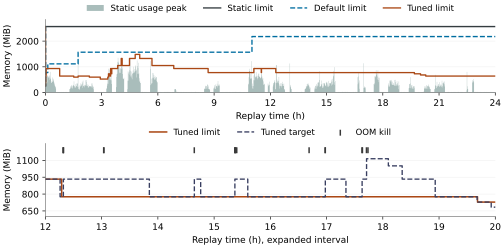
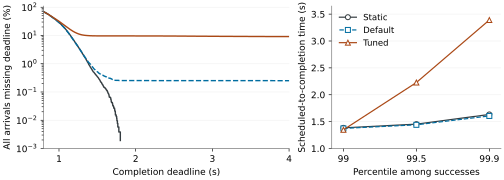
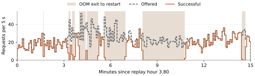

# Memory reclamation and request loss under in-place vertical autoscaling

**Abstract.** We replayed 52,092 arrivals from an Azure Functions trace to measure how in-place memory resizing affects a bursty function. The default Kubernetes Vertical Pod Autoscaler (VPA) reduced mean allocation by 27.4% relative to static and lost 131 requests. Shortening the memory aggregation interval from six hours to five minutes reduced mean allocation by a further 56.4% relative to default. Request losses rose to 4,771. Tuned had the lower 99th-percentile latency (p99) when each run counted its own successes. Static had the lower p99 for the requests that both completed. Of the requests that failed under tuning, 84.3% arrived between an out-of-memory (OOM) exit and the start of the next container.

## Experimental comparison

We replayed four trace days (window A, days 2 through 5) in 24 wall-clock hours on arm01. A single replica ran SeBS PageRank on a 100,000-vertex graph, forking one worker per request with at most 72 workers at once. The open-loop client continued to send requests on schedule during slowdowns and restarts.

All runs started with a memory request and limit of 2,565 MiB and a fixed 60-core CPU quota. Static kept the initial allocation. Default used memory-only VPA 1.7.1 in InPlace mode on Kubernetes 1.37.0, with time settings scaled for 4× replay. Tuned (iteration it2) shortened the interval for aggregating memory peaks by a factor of 72. All other settings matched default. In both runs, the recommender and updater ran every 15 s, and the recommender used eight aggregation intervals and a six-hour histogram decay half-life.

**Table 1. Service and resource use over 24 hours.** Mean allocation weights each applied memory limit by the time it was in effect. Mean utilization averages the ratio of cgroup usage to the active limit at each sample. Goodput is the number of successful requests per replay second. No request timed out.

| Metric | Static | Default | Tuned |
|---|---:|---:|---:|
| Mean allocation (MiB) | 2,565 | 1,863 | 812 |
| Mean sampled usage (MiB) | 61.0 | 60.8 | 56.9 |
| Mean utilization (%) | 2.38 | 3.56 | 6.63 |
| Successful / offered requests | 52,092 / 52,092 | 51,961 / 52,092 | 47,321 / 52,092 |
| Errors (share of arrivals) | 0 | 131 (0.251%) | 4,771 (9.159%) |
| Goodput (requests/s) | 0.6029 | 0.6014 | 0.5477 |
| Successful-request p50 / p99 (s) | 0.886 / 1.385 | 0.883 / 1.374 | 0.867 / 1.348 |
| OOM kills / container restarts | 0 / 0 | 6 / 6 | 57 / 56 |

## RQ1. How closely does the recommender track demand?

Under default VPA, the first recommendation reduced the limit to 250 MiB. Five increases brought the limit to 2,176 MiB at hour 11.02. It stayed there for the remaining 12.98 h, when one-second usage samples averaged 50 MiB and peaked at 1,117 MiB. Between the first six hours and the remaining eighteen, default’s mean allocation rose from 1,433 to 2,007 MiB while mean usage fell from 111 to 44 MiB. Usage fell similarly under static allocation, which served every request. With the six-hour aggregation interval, earlier peaks continued to influence the default recommendation as demand subsided.

The static run provides a reference for demand even when the autoscaled replica is down. For each one-second static usage sample after the first VPA recommendation, we calculated headroom as the target at the same replay time minus static usage. Median headroom was 2,013 MiB under default and 761 MiB under tuned. The target fell below static usage in 9 of 86,390 samples under default and 59 under tuned. One-second sampling can miss short peaks. The largest static sample was 1,448 MiB, while the cgroup recorded a high-water mark of 1,867 MiB. We used OOM events and client errors to identify service disruptions.

<!-- page -->

**Figure 1. Applied memory limits and VPA targets.** The upper panel compares applied limits at the same elapsed time in each replay. Shading shows the largest one-second static usage sample in each minute. The lower panel shows the tuned target and applied limit from hours 12 to 20, with a tick at each OOM kill.

Adding the experiment’s 15% sizing margin to the observed static high-water mark gives a retrospective estimate of 2,147 MiB. This is 16.3% below the fixed allocation we tested and below default’s final limit of 2,176 MiB. All service comparisons use the measured 2,565 MiB static run.

Under tuning, the applied limit stayed at 776 MiB from hour 12.29 until the next patch at hour 19.68. The recommended target exceeded the limit for 3.54 of those 7.39 h, with a target as high as 1,115 MiB. At every one-second check, the existing limit still fell within the recommender’s lower and upper bounds. The replica sustained 18 OOM kills during this interval, and 1,196 of 13,117 requests failed.

## RQ2. Where does resize time accumulate?

**Table 2. Resize timing from the API audit log.** For each patch, we matched the recommendation timestamp to the patch and to the first kubelet status that reported the new limit and a completed resize. The issue count includes patches with a reported resize error. The kubelet eventually applied every patch.

| Policy | Applied (up / down) | With issue | Target to patch, median | Patch to applied, median | Patch to applied, range |
|---|---:|---:|---:|---:|---:|
| Default | 6 (5 / 1) | 1 | 73 ms | 28 ms | 13 ms to 39.20 s |
| Tuned | 31 (14 / 17) | 11 | 184 ms | 48 ms | 13 ms to 304.97 s |

The median time from recommendation to application was 102 ms under default and 232 ms under tuned. Across both runs, the kubelet applied all 19 increases within 66 ms of the patch. Of 17 tuned decreases, 11 had an error and took 10.96 to 304.97 s to apply, with a median of 22.97 s. The other six took 42 to 65 ms. For ten of those eleven resizes, the kubelet reported missing container memory usage. The initial decrease in each run produced a memory-limit check error. Neither run recorded a deferred or infeasible resize.

At startup, the default recommender set a 250 MiB target at 10.1 s and raised it to 422 MiB at 25.1 s. The kubelet reported applying the earlier 250 MiB target at 49.4 s. Despite these delays, all 105 default and 323 tuned requests scheduled between a patch and its application succeeded. The longest tuned decrease took 305 s during an interval with no arrivals.

<!-- page -->

## RQ3. How does configuration change memory efficiency and tail performance?

Over 24 h, static reserved 60.12 GiB·h of memory, default 43.67 GiB·h and tuned 19.03 GiB·h. Default saved 16.45 GiB·h relative to static and completed 131 fewer requests. Tuned saved another 24.64 GiB·h relative to default and completed 4,640 fewer. Against the static baseline, tuning reduced mean allocation by 68.4% and goodput by 9.16%. Mean utilization reached 6.63%, or 2.79× the static value. Sampled usage was lower under tuning, so the utilization gain came from reducing the memory reserved.

Among each run’s successful requests, tuned had a p99 of 1.348 s and static a p99 of 1.385 s, an apparent 2.6% advantage for tuned. We matched requests by index. Their scheduled offsets from replay start agreed to within 2 μs. On the 47,321 requests that succeeded under tuned, static’s p99 was 1.311 s, making tuned 2.8% slower at p99. For the 4,771 requests that failed under tuned, static’s p99 was 1.639 s. Tuned therefore lost requests that tended to be slower under static allocation. At p99.9, tuned was slowest even among successes, at 3.390 s versus 1.634 s for static and 1.606 s for default.

**Figure 2. Deadline misses across all arrivals and tail latency among successes.** For a deadline *d*, the left panel counts errors and requests that succeeded after *d*, as a fraction of all 52,092 arrivals. The logarithmic axis shows positive fractions only. Static’s miss fraction reached zero by 1.823 s. The right panel shows latency percentiles for successful requests. Latency is measured from the scheduled send time.

Within two seconds, static completed 100% of arrivals, default 99.749% and tuned 90.371%. Tuned eventually completed 90.841% of arrivals. Only static and default reached 99% successful completion at any deadline.

**Table 3. Service outcomes on the first trace day and the following three days.** The first day accounted for 26,529 requests in six replay hours. The next three days accounted for 25,563 in eighteen hours. Each p99 uses the successful requests for that configuration and phase.

| Policy | Mean MiB, first / later | Errors, first / later | Successful p99 (s), first / later | OOM kills, first / later |
|---|---:|---:|---:|---:|
| Static | 2,565 / 2,565 | 0 / 0 | 1.442 / 1.263 | 0 / 0 |
| Default | 1,433 / 2,007 | 113 / 18 | 1.437 / 1.256 | 5 / 1 |
| Tuned | 893 / 785 | 3,043 / 1,728 | 2.269 / 1.190 | 28 / 29 |

On the first and busiest day, tuned p99 latency among successes was 57.3% higher than static’s. In the later phase, tuned p99 fell below static’s, but 6.76% of arrivals failed. Losses clustered in the busiest 148 of 1,440 replay minutes, the top decile including ties at 132 arrivals/min. These minutes accounted for 55.4% of arrivals and 92.2% of tuned errors. The tuned error rate was 15.25% in these minutes and 1.61% elsewhere.

The tuned run failed the experiment’s requirement to match the static failure rate. Hypothesis H1 asks whether tuning improves mean allocation or p99 by more than the run-to-run spread. Window A has one static run, one default run and one tuning iteration. Testing H1 requires three repetitions per policy. Transfer to window B remains untested.

<!-- page -->

### Burst arrivals amplify the cost of restarting

CPU throttling occurred in 14.13% of quota periods under static, 15.34% under default and 15.01% under tuned. Static served the same bursts without losing a request.

Using kubelet timestamps, we counted requests scheduled at or after each OOM exit and before the next container started. Under tuned, these 56 intervals totaled 1,106 s, or 1.28% of the replay. All 4,021 requests scheduled in them failed, accounting for 84.3% of tuned errors. Under default, six intervals totaled 30 s and accounted for 80 of 131 errors. The pod watch recorded restart backoff under both policies. During the longest tuned gap, 672 requests arrived in the 163 s it took to restart the sole replica.

**Figure 3. Request outcomes during repeated tuned restarts.** In the 15 minutes around the longest restart gap, 4,223 requests arrived and 2,009 failed. Both curves group requests by scheduled arrival in five-second bins. Shading starts at an OOM exit and ends when the successor container starts, which can precede its first successful request.

## RQ4. What can the traces establish about two competing VPAs?

The measured runs each used one isolated function. To estimate when two functions might compete for node memory, we placed the 52,092 target arrivals and 151,104 neighbor arrivals on the same window A clock. We assigned every invocation a fixed lifetime and counted the time for which both functions had at least three requests in flight. At the 0.330 s lifetime specified in the experiment design, overlap totaled 122.2 s and the combined peak was 18 concurrent requests. Using 0.885 s, the median time from send to completion in the static run, increased overlap to 1,541.0 s and the combined peak to 30.

Changing the assumed lifetime alone increased modeled overlap by a factor of 12.6. The isolated runs give a target-side baseline. A shared-budget replay with the neighbor present is still needed to measure actual overlap, competing pod allocations, resize deferrals, and either function’s change in tail latency, goodput or failure rate.

## Conclusion

Shortening the aggregation interval to five minutes saved an average of 1,051 MiB relative to default. During bursts, the tuned recommender could raise its target while the current limit remained within bounds through repeated OOMs. Because the function had one replica, a single OOM could leave hundreds of arrivals without service while the container restarted. Excluding those failures gave tuned an apparent p99 advantage over static. Static completed more requests and had the lower p99 for those both configurations served.

**Experimental record.** The window A [static run](../../results/A-static-r1-20261122-150847), [default run](../../results/A-default-r1-20261121-124656) and [tuned it2 run](../../results/A-tuned-it2-20261123-160509) each contain the configuration, client log, cgroup samples, pod and VPA watch records, and API audit log. The [analysis script](analyze.py) matches requests across runs, checks phase summaries against the archives and reproduces the figures. The [experiment specification](../spec.md) defines the research questions and selection criteria.
